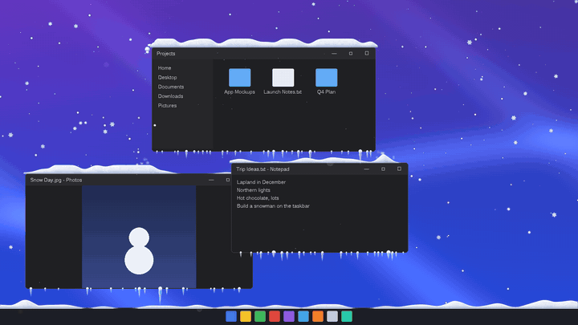

# Snowy ❄ snowfall for your Windows desktop

Snowy makes it snow on your Windows 10/11 desktop. The snow piles up on top of your windows and on the
taskbar, icicles grow under your windows, and it all reacts to what you do:



| | |
|---|---|
| **Shake a window** | the snow slides off and tumbles down in chunks |
| **Move a window** | its icicles snap off and shatter |
| **Close or minimize one** | the whole snow cap comes down at once |
| **Jerk a window hard** | the snow lags behind and spills off the end (real inertia) |
| **Leave it on** | your desktop slowly gets snowed in, right on top of the taskbar |
| **Now and then** | a snowman rolls itself together on the taskbar, gets a carrot nose, a scarf and a hat, and waves at you |
| **Flick the cursor** | through the falling snow to swirl it, through a snow pile to plow it, through a snowman to knock its head off |
| **Wind** | steady breezes or gusts blow the flakes around and whip powder off the piles |

Everything is drawn on the GPU (Direct3D 11 + DirectComposition) in a transparent, click-through overlay, so
it never gets in the way of your clicks and uses very little CPU.

## Download & run

1. Grab **`Snowy.exe`** from the [latest release](../../releases) (or from the *Actions* tab → latest run →
   `Snowy-windows-x64` artifact).
2. Double-click it. There's no installer — it's a single ~600 KB file. Put it anywhere you like.
3. Windows SmartScreen may say *"Windows protected your PC"* because the app isn't code-signed.
   Click **More info → Run anyway**.

A snowflake icon appears in the notification area (it might be hidden under the **^** arrow next to the
clock). **Right-click it** for the menu, **left-click it** for settings.

## Tray menu

- **Let it snow** — turn the snowfall on/off (snow that has piled up stays)
- **Snowfall** — Light flurries / Steady snowfall / Heavy snow / Blizzard!
- **Wind** — Calm / Breeze → / Breeze ← / Gusty / Snowstorm
- Toggles for snow on windows, icicles, snow on the taskbar, snowmen and cursor play
- **Build a snowman now**, **Avalanche!** (shakes the snow off every window), **Shovel the taskbar**,
  **Melt everything**
- **Hide snow**, **Settings…**, **Start with Windows**, **Quit**

## Settings

Sliders for amount, flake size, fall speed, wind direction & gustiness, how fast snow piles up, how deep it
gets on windows and on the taskbar, flake style (mixed / soft dots / crystals), snowman frequency, frame rate
(30 / 60 / match display), plus:

- **Pause during full-screen apps & games** (on by default) — the overlay hides itself entirely, so games and
  videos are never affected
- **Battery saver** (on by default) — 30 fps and fewer flakes when your laptop is unplugged
- **Shadowed flakes** — a faint outline so snow is visible on white windows too
- **Hide snow from screen sharing** — Teams/Zoom/OBS captures won't see the snow (Windows 10 2004+)

Settings are saved to `%APPDATA%\Snowy\Snowy.ini`.

## Hotkeys

| Ctrl + Alt + Shift + | |
|---|---|
| **S** | hide / show the snow |
| **A** | avalanche — shake the snow off all windows |
| **M** | build a snowman |
| **D** | melt everything |

## Tips

- On **Windows 10**, shaking a window also triggers Windows' own *Aero Shake* (it minimizes all other windows —
  and their snow comes down too!). Turn that off under *Settings → System → Multitasking → Title bar window
  shake* if you only want the snow to fly.
- Snow only settles where it can actually land: on the visible part of a window's top edge. Windows in front
  hide the snow behind them, just like real ones.
- Snowy works across multiple monitors with different scaling (it's per-monitor DPI aware).
- Snowy pauses completely while the screen is locked or off.

## Requirements

- Windows 10 or 11, 64-bit
- Any DirectX 11 capable GPU (practically everything from the last decade; it falls back to software
  rendering if needed)

## Building from source

**Visual Studio 2022 / CMake (Windows):**

```bat
cmake -S . -B build -G "Visual Studio 17 2022" -A x64
cmake --build build --config Release
```

The result is `build\Release\Snowy.exe` (statically linked, no runtime needed).

**MinGW-w64 cross-compile (Linux):**

```bash
sudo apt install g++-mingw-w64-x86-64-posix
./build.sh
```

The GitHub Actions workflow builds with MSVC on every push, runs an automated self-test on a real Windows
desktop (shake / move / close / snowman, with screenshots) and publishes `Snowy.exe` as an artifact. Pushing a
tag like `v1.0.0` creates a GitHub release with the exe attached.

### Developer command-line options

```
Snowy.exe --demo                  also opens three demo windows to play with
Snowy.exe --selftest <dir>        scripted run on the real desktop, saves screenshots, exits
Snowy.exe --render-test <dir>     renders a scripted scene offscreen to PNG frames
          [--seconds 30] [--every 3] [--size 1600x900] [--scale 1.0]
Snowy.exe --fallback              force the layered-window presentation path
Snowy.exe --warp                  force software (WARP) rendering
Snowy.exe --speed 10              speed up accumulation (testing)
Snowy.exe --verbose               log to stderr as well
```

A log is written to `%LOCALAPPDATA%\Snowy\snowy.log`.

## How it works

- **Overlay** — one borderless, top-most, click-through (`WS_EX_LAYERED | WS_EX_TRANSPARENT`) window per
  monitor with a premultiplied-alpha DirectComposition swap chain; a layered-window path exists as a fallback.
- **Window tracking** — every frame the visible top-level windows are enumerated in z-order, with their true
  visible bounds from DWM (no invisible resize borders), cloaked windows (other virtual desktops) are skipped,
  and drags are detected through `EVENT_SYSTEM_MOVESIZESTART/END` hooks.
- **Occlusion** — window rectangles are written into a depth buffer by z-order, so snow and icicles belonging to
  a window are hidden by any window in front of it.
- **Snow piles** — each window top (and the taskbar) carries a 1-D heightfield. Flakes deposit into it, an
  angle-of-repose relaxation plus mass-conserving diffusion settle it into smooth, rounded layers, the ends are
  rounded off and overflow tumbles off the edges. A pixel shader renders it with lighting, grain and sparkles.
- **Physics** — window velocity/acceleration are tracked to detect shakes (several fast direction reversals)
  and hard jerks (the snow slides by inertia). Detached snow becomes tumbling capsule-shaped chunks that break
  on impact and merge into whatever pile they land on; icicles shatter into ice shards.
- **Everything else** (chunks, snowballs, icicles, coal, carrots, sticks, scarves, hats, water drops, powder)
  is drawn as signed-distance-field primitives with per-material shading.
